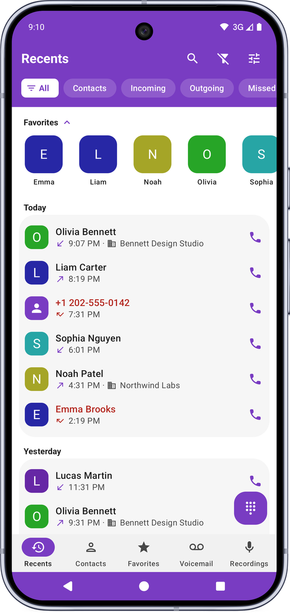
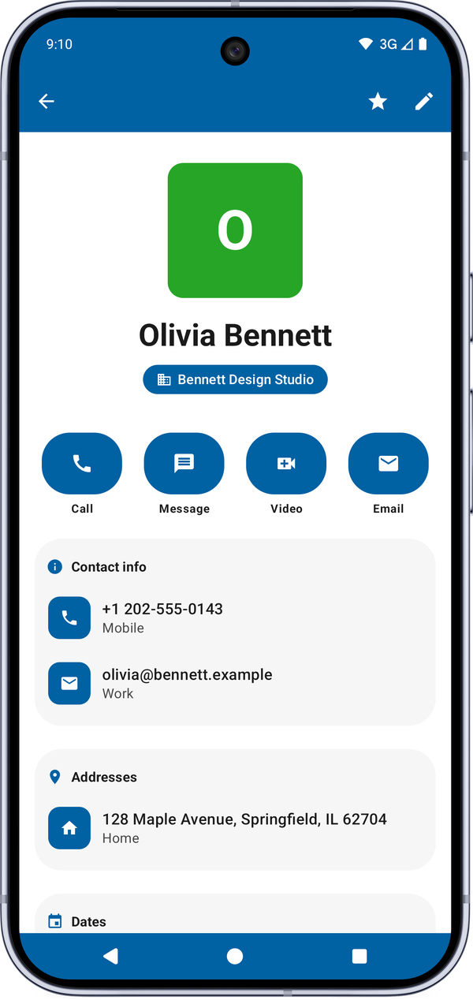
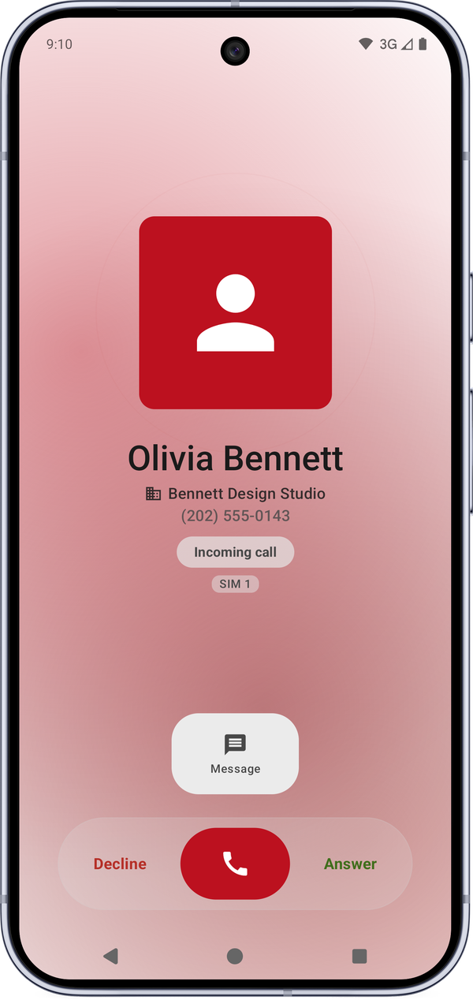
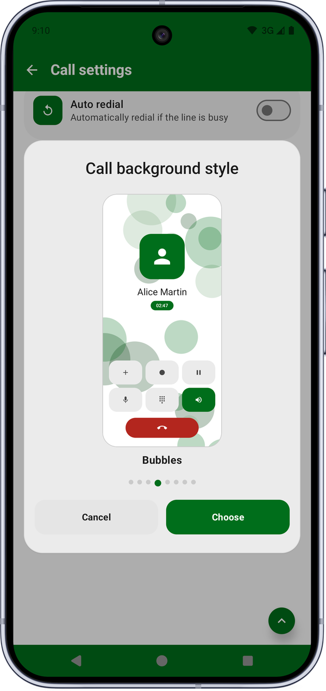

# AukDialer

**A modern, free and open-source Phone app for Android.** 
**No ads, no tracking, no Google services.**

---

## 📸 Screenshots

<picture><source media="(prefers-color-scheme: dark)" srcset=".github/assets/screenshots/recents-dark.png"></picture>
<picture><source media="(prefers-color-scheme: dark)" srcset=".github/assets/screenshots/details-dark.png"></picture>
<picture><source media="(prefers-color-scheme: dark)" srcset=".github/assets/screenshots/incoming-dark.png"></picture>
<picture><source media="(prefers-color-scheme: dark)" srcset=".github/assets/screenshots/custom-dark.png"></picture>

A different color on every screenshot: I like to leave the choice to you, the app and even its icon take the color you want.

---

## ✨ Highlights

- **Customizable call screen**: animated, plain, gradient or photo backgrounds, and four ways to answer.
- **Call recording** through Shizuku.
- **T9 search**, filterable call history, encrypted private contacts and call blocking.
- **Customizable from end to end**: Material You colors or 20 colors of your choice, and the **app icon** on your home screen can take the same color. AMOLED mode, 11 avatar shapes, Material 3 Expressive design.
- **Edge to edge mode**, optional: the app draws under the status and navigation bars, and the header folds away as you scroll to leave all the room to the content.
- **Adjustable vibrations**, one by one, with a live preview.
- **No ads, no tracking, no Google services**: works on LineageOS, GrapheneOS or /e/OS.

> [!NOTE]
> **Visual voicemail** is experimental: it has only been tested with one French carrier, and support for other carriers will depend on feedback from the community.

---

## 🧪 Why an alpha?

AukDialer is still under development. I use it every day as my main Phone app, but I prefer to test it thoroughly, on more phones and in more situations, before releasing a final version.

Until then, bugs are still possible. If you find one, open an issue: every report helps reach the final version sooner.

Using AukDialer heavily and noticing lots of things day after day? Rather than opening one issue per bug, open **a single one** with the full list, and keep adding to it as you go. Tracking is much simpler for everyone.

I'm also open to **feature requests**: if something is missing from your daily use, suggest it in an issue.

---

## 📥 Download

AukDialer will **never** be published on the Google Play Store. I don't want to depend on Google, nor pay for the right to share a free app, nor bend to rules that keep changing at Google's whim. For me, that goes against the very spirit of open source.

I recommend installing AukDialer with **[Omnify](https://github.com/Victor-root/Omnify)**, my app store: an F-Droid client that also installs and updates apps published directly on GitHub, GitLab or Codeberg. You get every AukDialer update as soon as it is out, without having to fetch it by hand.

  &nbsp;&nbsp;&nbsp;&nbsp;&nbsp;

---

## 🤝 Contributing

Bug reports, ideas, translations and pull requests are welcome. Everything is explained in the [Contributing Guide](CONTRIBUTING.md).

---

## 🔀 Why this fork?

I started out as a contributor to **Rivo**. I loved the app and gave my time to make it better.

Then, in September 2026, AdMob ads were added to it. That's the day I stopped contributing and started this fork. A Phone app has access to all your contacts and your call history: putting an ad kit in it is a betrayal of the people who trusted it, and a slap in the face of open source, from a project built with the help of its community.

Rivo has since [become proprietary](https://github.com/user-grinch/RivoPhone/discussions/371): one more betrayal, this time of everyone who contributed code and translations to it under GPL v3. It only confirmed I was right to leave. AukDialer only relies on the code Rivo published under GPL v3, before that change, and will stay free: no ads, no tracking, ever.

---

## 💜 Support

AukDialer is free, and will stay that way. I build it in my spare time, because I love open source and want a Phone app I can trust.

The simplest way to help costs nothing: **⭐ star the repository**. It helps other people find AukDialer, and it shows me the project is worth the time I put into it. A bug report or a translation helps a lot too.

And if you feel like giving something back, you can, entirely optional:

- **Bitcoin (BTC)**: `bc1q0juq85jc0ja56uw6y3vgr027czsw26cam926tn`
- **Monero (XMR)**: `8BwqFRk7ofSLkYq2gtRyWEBQit86C58M6SebpEL7kP5R2vWPsAUGobGDMfR3aKA1jHJ5Qp8qbYyNLZLFv9z6YBdaKixGyPt`

---

## 📄 License

GPL v3. See [LICENSE](LICENSE). Based on the GPL v3 code of Rivo by [Grinch_ (user-grinch)](https://github.com/user-grinch).
